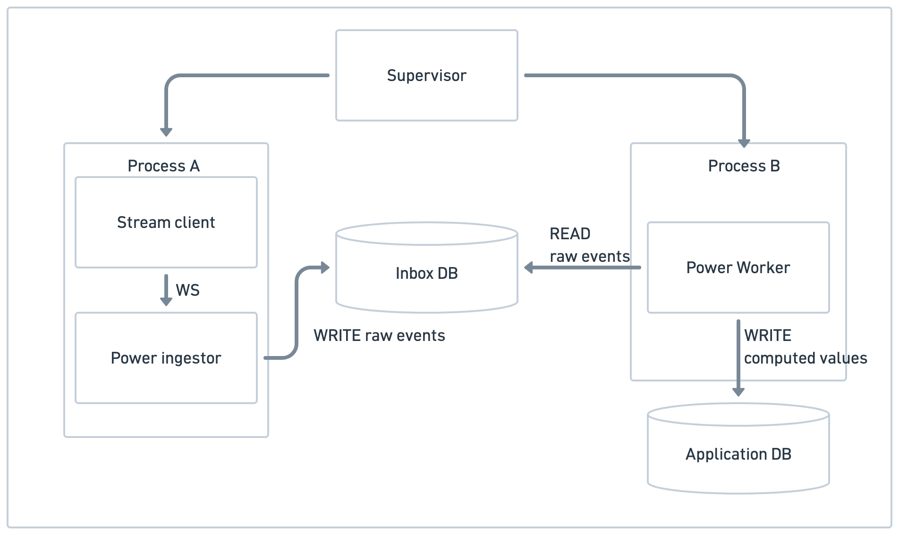

# Power ingestion change summary

## What was added

Power ingestion now runs as two supervised processes with a durable SQLite inbox
between the BMS feed and the application database. The change adds the inbox
interface and SQLite implementation, a collector and worker, a committed-minute
marker, shared logging, and tests for replay and failure recovery.

## End-to-end flow

`BMS WebSocket → stream client → collector → SQLite inbox → worker → application SQLite database`

1. The stream client authenticates with the BMS, parses WebSocket JSON, and yields
   events that contain `metrics`. It handles the connection; it does not use a database.
2. The collector serializes each yielded event to JSON bytes and commits it to the
   inbox as `pending`, with its datacenter ID and receipt time. This commit is the
   first durable point in the pipeline.
3. The worker claims up to 500 `pending` or `in_flight` messages at a time. It
   validates power and timestamps, converts kW to watts and timestamps to UTC,
   checks the device is a rack PDU in the selected datacenter, and deduplicates
   readings by device and observation time. Invalid, unknown, duplicate, future,
   and late readings are acknowledged without affecting an average. When spike
   filtering is enabled, readings above twice device capacity are also dropped.
4. Accepted readings remain `in_flight` in the inbox while the worker accumulates
   them in memory by device and minute. A minute closes 30 seconds after its end
   by default, allowing some buffer for late and out of observation-time messages. When replaying a backlog, the worker uses message receipt times
   to avoid closing a minute before earlier received messages have been examined.
5. For each device with accepted readings, the worker commits one average to
   `power_readings`, a row in `finalized_power_minutes`, and the accepted-sample
   histogram in `power_minute_coverage` in the same application database
   transaction. Only after that commit does it mark the contributing
   inbox messages `acked`. i.e. this is a transactional failure point: if the application commit fails, the inbox messages remain unacknowledged and can be replayed after restart.

   Minute logs include the sample-count distribution and
   device coverage; sparse minutes average only their valid observed samples.

## BMS feed reliability fixes

The retained feed showed exact repeats, receipt delays, implausible spikes, and
uneven sample counts. The worker now handles them as follows:

| Issue | Behavior |
| --- | --- |
| Repeated readings | One reading per device and observation time contributes to an open minute. Exact repeats are acknowledged as `duplicate`; if values conflict, the first is kept and the later frame is logged and acknowledged as `conflicting_duplicate`. The finalized-minute marker also prevents a second result after a worker restart. |
| Delayed readings | Readings received before the minute's deadline are included even if they arrive out of observation-time order. The default deadline is 30 seconds after the minute ends. Later readings are dropped with their observation, receipt, and deadline times logged; accepted readings delayed by over one second are counted. |
| Power spikes | When `BMS_FILTER_POWER_SPIKES=1` (the default), the worker loads each rack PDU's rated capacity and drops readings above twice that capacity as `spike` before they enter an average. Set the flag to `0` and restart ingestion to disable the filter; other values fail at startup. The log names the device, time, measured power, and capacity. A rejected spike does not reserve its observation time, so a later valid reading can still contribute. |
| Uneven coverage | Each device-minute averages only its valid observed samples; missing samples are not filled in. The worker commits a histogram of accepted sample counts alongside the minute and logs it. The dashboard shows this histogram for the latest finalized minute, so sparse or partial minutes can be identified without assuming a fixed BMS cadence. Older minutes have no recorded histogram and display as unavailable. |

Tests cover repeats, conflicts, delayed and out-of-order arrivals, spike rejection,
the disabled flag, sparse coverage, and a minute containing only a spike. The
twice-capacity cutoff is a heuristic pending calibrated device limits. Existing
stored averages are not recalculated by this change.

## How these issues were discovered
The retained feed was captured in a diagnostic run on 11 October 2026. The run
showed 5,067 exact repeats, 20,843 delayed readings, 1,132 implausible spikes, and uneven sample coverage. The diagnostic queries are
in `power_ingest_diagnostics.sql` and can be rerun with `make diagnostics < diagnostics.txt`. The run does not establish whether BMS disconnects occur, and it does not prove out-of-order delivery. The diagnostic queries select the largest capacity breach and inspect that rack and minute.

## Modeled output comparison

`make output-diagnostics` compares the older `data/model_dc_6e63013.db` snapshot
with `data/model_dc.db`, captured after the fixes with spike filtering enabled.
The query is in `power_output_diagnostics.sql`; its saved output is
`output_diagnostics.txt`. A device-minute is one stored average for one device
and one minute.

| Snapshot | Stored UTC minutes | Device-minutes | Above rated capacity | Above 2x capacity | Highest / capacity |
| --- | --- | ---: | ---: | ---: | ---: |
| Before fixes | 2026-10-12 10:52–10:56 | 4,997 | 797 (15.95%) | 736 | 30.66x |
| After fixes | 2026-10-12 11:14–11:17 | 4,000 | 0 (0%) | 0 | 0.67x |

## Processes and storage

| Process | Runs | Reads | Writes |
| --- | --- | --- | --- |
| Collector | `PowerIngester` in `ingestion/power_ingester.py` | BMS via `ingestion/stream_client.py` | JSON event bytes and `pending` status in `data/power_inbox.db` |
| Worker | `PowerWorker` in `ingestion/power_ingester.py` | Inbox; rack PDU IDs and finalized minutes from the application DB | Inbox claim/ack state; per-device minute averages, coverage histograms, and finalization rows in `data/model_dc.db` |
| Supervisor | `jobs/run_power_ingest.py` via `make ingest` | Child exit status | Starts, restarts, and stops the two processes; writes no telemetry |

The inbox uses its own SQLite connections and WAL mode. The worker uses separate
SQLAlchemy sessions for application database work; no mutable session is shared
with the collector. `DATABASE_URL` can override the application database path;
the default inbox path is `data/power_inbox.db`.

## Failure and recovery

| Failure | Current behavior |
| --- | --- |
| BMS disconnect or normal stream end | Collector reconnects with bounded exponential backoff. Authentication rejection stops ingestion instead of retrying indefinitely. |
| Inbox write is temporarily unavailable | Collector retries the same event before reading the next one. |
| Collector or worker exits unexpectedly | Supervisor restarts that process. The collector and worker continue independently. |
| Worker stops after claiming, before application commit | The new worker reclaims unacknowledged `in_flight` messages and rebuilds open minutes. |
| Application commit succeeds, but inbox acknowledgement fails | The committed finalization row prevents a second average; replay acknowledges the message. |
| Application commit fails | Messages remain unacknowledged and can be replayed after restart. |
| Acknowledged messages age out | Worker cleanup removes `acked` inbox rows after one hour by default; pending and `in_flight` rows are retained. |

The BMS has no replay, so events lost before the inbox commit cannot be recovered.
The stream client filters non-metric events before persistence, and malformed
WebSocket JSON does not reach the inbox. The claim protocol assumes one worker
per datacenter; parallel workers would need ownership or lease handling.

## Running and configuration

For a fresh setup, `make seed` creates the application schema and datacenter
fixtures; it drops existing application tables if run again. Set `BMS_TOKEN`
and run `make ingest`. Optional settings are `BMS_WS_URL`,
`BMS_DATACENTER_ID` (default `1`), `BMS_ALLOWED_LATENESS_SECONDS` (default `30`),
`BMS_INBOX_RETENTION_HOURS` (default `1`), and `BMS_FILTER_POWER_SPIKES` (default
`1`; set `0` to disable). `make seed` recreates application
tables but leaves the inbox in place. `make clean` deletes the two main SQLite
database files; stop ingestion before using it.

## Limitations / Not implemented

- The worker does not yet check for missing BMS readings. It does not attempt to
   detect or fill in missing samples, and it does not track the last received
   observation time per device (i.e. it does not know if a device has stopped sending readings / have a sense of queue depth for a device)
- The finalized-minute marker prevents sa second average after a worker restart, but it  does not prevent a second average if the
   worker is stopped and restarted before the minute is finalized.
- Further separation of the collector and worker into independent services is possible, but the current implementation runs them in a single supervisor process. The inbox is durable and can be shared between separate processes if desired.
- No configuration is provided for multiple datacenters or multiple workers per datacenter. The claim protocol assumes one worker per datacenter; parallel workers would need ownership or lease handling.
- No confidence level or quality-of-service metrics are reported. The worker logs rejected frames by reason, minute completions (including sample counts per device), and periodic counters.
- No heartbeat or liveness checks are implemented. Ideally the supervisor would report the status of its child processes to a monitoring system, and the worker would report its progress on backlog replay and minute finalization.
- No recomputation of existing stored averages is performed. The worker does not recalculate averages for previously finalized minutes, even if events come in later that would have contributed to those averages.
